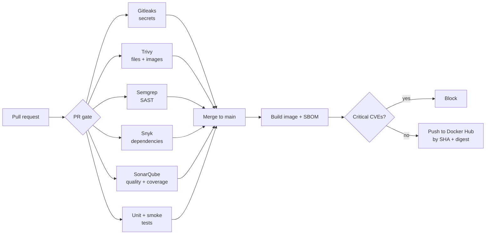

# Cliff Gita

### DevOps & Cloud Engineer · AWS · Terraform · Kubernetes · DevSecOps

I build secure, automated and observable cloud platforms, and ship them through CI/CD pipelines that check every change before it reaches production.

  
  
  

---

## About me

- DevOps engineer with **6+ years in open-source digital health** and **420+ merged pull requests**.
- **OpenMRS Platform 2.4 Release Manager** and **OpenMRS Fellow (2020/21)**, working on FHIR, PLIR and the analytics engine.
- Software engineer at the **Digital Initiatives Group, University of Washington** (2022–2025), working on OpenELIS Global and Community Health Toolkit.
- Today I focus on **AWS infrastructure as code, Kubernetes, DevSecOps pipelines and observability**.
- Based in Kampala, Uganda · open to remote DevOps and cloud roles.

---

## Featured projects

| Project | What it shows | Stack |
|---|---|---|
| [**AWS Serverless Web Platform**](https://github.com/gitcliff/aws-serverless-web-platform) · [demo](https://www.youtube.com/watch?v=PMeldVsWBpc) | Six-tier production app built entirely in Terraform. Deploys through GitHub Actions OIDC with no long-lived AWS keys. WAF on the edge, plus X-Ray tracing, CloudWatch alarms, Synthetics canaries and SLOs. | Terraform · Lambda · API Gateway · DynamoDB · CloudFront · WAF · Route 53 |
| [**Microservices DevOps Stack**](https://github.com/gitcliff/microservices-devops-stack) | 7 containerized services deployed to Kubernetes, with Prometheus and Grafana in the cluster. Every PR passes 9 security and quality checks, and every image ships with an SBOM and a vulnerability scan before it is published. | Kubernetes · Docker · GitHub Actions · Trivy · Semgrep · Snyk · SonarQube |
| [**Ubuntu Cloud Support Lab**](https://github.com/gitcliff/ubuntu-cloud-support-lab) | Reproducible break/fix labs for systemd, DNS, LVM, apt and LXD networking, each with a root-cause write-up. Includes a diagnostics script tested in CI. | Linux · Bash · bats · ShellCheck · Multipass/LXD |
| [**Jenkins CI/CD Automation**](https://github.com/gitcliff/Build-Automation-CICD-with-Jenkins) | Declarative and multibranch pipelines, shared libraries, webhooks, automatic versioning, and Docker image builds pushed to Docker Hub and Nexus. | Jenkins · Groovy · Maven · Docker · Nexus |
| [**Nexus Artifact Management**](https://github.com/gitcliff/Artifact-Repository-Manager-with-Nexus-Projects) | Running Nexus on a cloud server: publishing artifacts, using the REST API and managing blob stores. | Nexus · Maven · Gradle · DigitalOcean |
| [**3-Tier App on EKS**](https://github.com/gitcliff/3-Tier-app-on-eks) *(in progress)* | Flask and React app with security-first CI, being prepared for deployment to Amazon EKS. | Python · React · PostgreSQL · Docker · EKS |

---

## How I ship code

The pipeline in [microservices-devops-stack](https://github.com/gitcliff/microservices-devops-stack/tree/main/.github/workflows): untrusted PR code never sees registry credentials, and only scanned images get published.

Every job runs with least-privilege permissions, third-party actions are pinned to commit SHAs, and scan results go to GitHub code scanning.

---

## Tech stack

**Cloud & IaC**

  
  
  
  

**Containers & CI/CD**

  
  
  
  
  
  

**DevSecOps**

  
  
  
  
  
  

**Observability**

  
  
  
  

**Linux, languages & tools**

  
  
  
  
  
  
  

---

## Open-source contributions

| Community | Role | Highlights |
|---|---|---|
| [OpenMRS](https://openmrs.org) | [Platform 2.4 Release Manager](https://talk.openmrs.org/t/platform-2-4-release-manager-cliff-gita/29566) · [Fellow 2020/21](https://talk.openmrs.org/t/my-fellowship-journey-cliff-gita/31148) · Contributor since 2019 | 110+ merged PRs across openmrs-core, the FHIR2 module, O3 microfrontends and distribution packaging |
| [DIGI, University of Washington](https://digi.uw.edu) | Software Engineer (2022–2025) | 220+ merged PRs to OpenELIS Global 2 and Community Health Toolkit apps; built OE Watchdog, a Prometheus/Grafana monitoring stack |

---

## Currently

- 🔭 Taking the Kubernetes deployment further: Helm charts and GitOps with Argo CD
- 🚀 Deploying the 3-tier app to Amazon EKS with Terraform
- 📚 Preparing for AWS certification

---

 

**Build · Automate · Secure · Observe**

